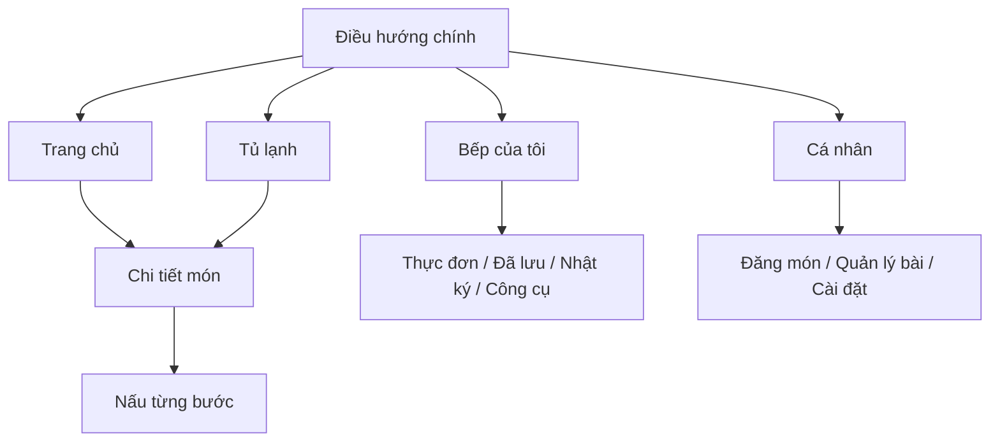

# Kế hoạch thiết kế lại toàn bộ giao diện Bếp Xinh

Ngày: 16/11/2026. Trạng thái: đã triển khai; xem [bàn giao và kiểm chứng](UI_UX_PREMIUM_IMPLEMENTATION.md).

Phạm vi chính: toàn bộ Flutter app trên điện thoại, tablet và web, cả sáng/tối.
Trang quản trị có giai đoạn hoàn thiện riêng ở cuối. Sollume chỉ được đọc để tham
khảo; đợt lập kế hoạch này không sửa source UI hoặc deploy ứng dụng nào.

Tài liệu này giữ đề xuất đã được duyệt tiếp theo sau `UI_UX_UPGRADE_PLAN.md` và
`INSTAGRAM_UI.md`. Phạm vi thực tế và bằng chứng nằm trong bản bàn giao phía trên.

## 1. Kết quả mong muốn

Người dùng mở mỗi màn và nhận biết được: đây là đâu, có thể làm gì, bước tiếp theo
là gì. Cảm giác cao cấp đến từ thứ bậc rõ ràng, ảnh tốt, khoảng cách có chủ đích,
chữ dễ đọc và phản hồi nhất quán. Giữ màu cam chủ đạo và Be Vietnam Pro.

Ba hành trình được ưu tiên xuyên suốt:

1. Tìm một món phù hợp → xem nguyên liệu → bắt đầu nấu.
2. Chọn nguyên liệu đang có → biết nấu được món nào và còn thiếu gì.
3. Lưu hoặc lên thực đơn → tìm lại nhanh khi cần nấu.

Đăng công thức, giao tiếp, theo dõi tác giả và quản trị vẫn có chỗ rõ ràng, nhưng
không cạnh tranh với ba hành trình trên trong mọi màn hình.

## 2. Những điểm xác nhận từ source hiện tại

| Quan sát | Ảnh hưởng có thể gây ra | Quyết định đề xuất |
|---|---|---|
| `AppBottomNavBar.showLabels` mặc định false và mobile shell không bật nhãn | Người mới phải đoán biểu tượng và vị trí tính năng | Hiện nhãn của mọi điểm đến chính |
| Home có chuyển bảng tin, hàng ảnh tròn, danh mục, lối vào Tủ lạnh rồi mới tới feed | Nhiều lớp nội dung cùng tranh sự chú ý | Rút phần đầu Home thành header, tìm kiếm và một vùng khám phá rõ ràng |
| Banner công thức được trình bày giống story ảnh tròn | Có thể bị hiểu thành story hoặc hồ sơ tác giả | Dùng khối món nổi bật có ảnh chữ nhật và tên mục rõ nghĩa |
| Nhiều công cụ trong `RecipeKitchenActions` nằm gần nội dung món | Khó nhận ra thao tác quan trọng nhất | Nấu là hành động chính; công cụ mở rộng vào menu có nhãn |
| Kitchen Hub có bảy card cùng cấp và phần giới thiệu dài | Người dùng phải đọc nhiều để tìm đúng việc | Chia nhóm theo việc cần làm; giảm lời giới thiệu chung chung |
| Tủ lạnh và Kho theo lô là hai mô hình riêng, lối vào Kho chủ yếu là icon | Người dùng dễ nghĩ hai nơi là cùng một danh sách | Giải thích rõ hai chức năng, đặt cùng một vùng điều hướng |
| Profile có tab ảnh bằng icon; các công cụ cá nhân xuất hiện ở nhiều vị trí | Khó phân biệt bài đã đăng, đã lưu và công cụ bếp | Tab có chữ; phân biệt hồ sơ công khai và quản lý cá nhân |
| Đi chợ vẫn chứa danh sách mẫu trong state local | Một vị trí điều hướng chính dễ tạo kỳ vọng sai | Đưa khỏi điều hướng chính của bản dùng thật; giữ phạm vi giỏ đi chợ thật đã bị loại |
| Editor, Settings, Kitchen và feed dùng nhiều kiểu section/card/form khác nhau | Thiếu cảm giác một hệ thống thống nhất | Chuẩn hóa component trước khi đi hết các màn |
| Card feed vừa được rút còn một hành động mở chi tiết | Đây là hành vi đã được người dùng yêu cầu | Giữ nguyên: chạm card mở món; lưu/đánh giá/chia sẻ là hành động riêng |

Đây là nhận xét từ source và contract, chưa phải kết quả quan sát người dùng thật
hoặc audit ảnh render mới của mọi màn. Đợt đầu cần kiểm chứng thêm trên bản render.

## 3. Các mẫu lấy từ Sollume

Đã đọc các nguồn dưới `D:/Sollume-Project/sollume_app`:

| Nguồn | Cách áp dụng cho Bếp Xinh |
|---|---|
| `docs/README_DEVELOPMENT.md` | Một quy ước khung trang, token và ownership cho toàn app |
| `lib/core/theme/app_theme.dart`, `app_sizes.dart`, `app_spacing.dart`, `app_text_styles.dart` | Theme tập trung, gutter/content rail nhất quán, text scale có giới hạn và khoảng cách theo thang |
| `lib/shared/app_menu_section.dart`, `app_menu_tile.dart` | Nhóm menu có tiêu đề; một hàng trình bày một việc, với nhãn và thông tin hỗ trợ ngắn |
| `lib/shared/README.md` | Cùng kiểu dialog, sheet, trạng thái rỗng/lỗi/không khả dụng trên toàn app |
| `SettingsThemeScreen`, `SettingsContent` | Mẫu trang con gọn: tiêu đề, back, một vùng cuộn, nội dung có giới hạn chiều rộng |
| `lib/features/home/presentation/widgets/home_content.dart` | Các section cùng gutter, nhịp khoảng cách rõ, tách vùng nội dung theo vai trò |

Bếp Xinh giữ nhận diện cam, ảnh món ăn và các hành trình nấu ăn. Việc áp dụng là
chuẩn hóa trong component của Bếp Xinh, không tạo dependency giữa hai repo.
Chính sách retry, persistence theme và dữ liệu vẫn theo contract hiện có của Bếp
Xinh; không tự đổi theo một mẫu UI trong Sollume.

## 4. Cấu trúc thông tin và điều hướng đề xuất

Điều hướng chính có bốn điểm đến với icon và chữ:

**Trang chủ · Tủ lạnh · Bếp của tôi · Cá nhân**

- Trang chủ: khám phá công thức; tìm kiếm ở vị trí dễ thấy.
- Tủ lạnh: chọn nguyên liệu và tìm món; lối vào quản lý số lượng/hạn dùng có nhãn.
- Bếp của tôi: thực đơn, công thức đã lưu, bộ sưu tập, nhật ký và công cụ nấu.
- Cá nhân: hồ sơ, công thức đã đăng, đăng món mới, quản lý bài và Cài đặt.

`Đăng món` là nút có chữ trong vùng quản lý bài của Cá nhân, thay vị trí dấu cộng
không nhãn hiện nay. Tin nhắn và Thông báo dùng icon phổ biến, tooltip/semantics và
tiêu đề màn rõ ràng. Các thao tác ít dùng nằm trong menu có nhãn.

Đã lưu xuất hiện trong Bếp của tôi; hồ sơ cá nhân giữ hai tab có chữ `Đã đăng` /
`Đã lưu` để không làm mất thói quen hiện tại. Cùng một nguồn dữ liệu và cách mở món.

Đây là phương án cần nghiệm thu cùng prototype. Khi triển khai đổi navigation,
phải xử lý branch stack, back/deep link và route Đi chợ cũ; không xóa route hoặc
dữ liệu cá nhân chỉ để làm gọn thanh điều hướng.

## 5. Ngôn ngữ thị giác

### Màu và chiều sâu

- Light dùng nền gần trắng, chữ đậm trung tính, một lớp surface phụ nhẹ.
- Dark dùng nền than rất tối, surface phân biệt vừa đủ; chữ và viền có tương phản.
- Cam chủ đạo cho nút chính, lựa chọn đang hoạt động và điểm nhấn cần chú ý.
- Đường phân cách mảnh, ít đổ bóng; một nhóm nội dung dùng một surface.
- Mỗi vùng chỉ dùng một cách nhấn mạnh chính; tránh đồng thời khung đậm, nền màu,
  icon lớn, chữ in hoa và tiêu đề quá đậm cho cùng một nội dung.

### Chữ và khoảng cách

- Giữ Be Vietnam Pro; cấp chữ được định nghĩa tập trung trong theme.
- Mức đề xuất: tiêu đề trang 24–28, section 18–20, nội dung 15–16, phụ đề 13–14.
- Dùng weight 400/500/600; 700 dành cho vài tiêu đề và nội dung cần nhấn mạnh.
- Thang khoảng cách 4/8/12/16/24/32; lề mobile 16, tablet 24–32 tùy rail.
- Bo góc thống nhất theo vai trò: control 8, khối nội dung/ảnh 12, sheet/dialog 16.
- Vùng chạm mục tiêu tối thiểu 48; nội dung dài và chữ lớn phải cuộn được.

### Ảnh và biểu tượng

- Ảnh món là yếu tố nổi bật chính; giữ cùng cách crop và fallback trong từng loại card.
- Feed một cột dùng ảnh lớn; tìm kiếm/thư viện dùng card gọn hơn để so sánh món.
- Một hệ icon Phosphor theo vai trò; icon tuyến chính có chữ, trạng thái chọn rõ.
- Hành động quan trọng ghi rõ đối tượng: `Thêm nguyên liệu`, `Thêm vào thực đơn`,
  `Gửi duyệt`; tránh các nút chỉ ghi `Thêm`, `Xác nhận` hoặc dấu cộng không ngữ cảnh.

## 6. Kế hoạch theo toàn bộ nhóm màn hình

| Nhóm màn | Bố cục và hành vi đề xuất | Hành động chính |
|---|---|---|
| Đăng nhập, đăng ký, quên mật khẩu | Khối form gọn, nhãn luôn nhìn thấy, một lời giải thích đúng mục đích; lỗi dưới trường; form cuộn khi có bàn phím | Đăng nhập / Tạo tài khoản / Gửi hướng dẫn |
| Trạng thái tài khoản, phiên, khóa | Thông báo rõ trạng thái và đường tiếp tục; giữ guard thật, không đưa người dùng vào màn trắng | Đăng nhập lại hoặc thoát phiên khi phù hợp |
| Home và bảng tin theo dõi | Header gọn, tìm kiếm rõ, vùng món nổi bật có nhãn; feed thống nhất. Theo dõi là chế độ nội dung phụ có trạng thái chọn rõ. Card mở chi tiết một lần | Chọn một món |
| Tìm kiếm, lọc | Ô tìm kiếm rõ, bộ lọc đang áp dụng nhìn thấy, số kết quả khi có dữ liệu thật; filter sheet có Áp dụng/Xóa lọc | Tìm món phù hợp |
| Tủ lạnh, chọn nguyên liệu | Mô tả ngắn `Chọn nguyên liệu để tìm món`; tóm tắt nguyên liệu và kết quả tách rõ; món ghi còn thiếu gì | Chọn nguyên liệu / Xem món |
| Kho nguyên liệu, số lượng/hạn dùng | Đổi tên hiển thị `Nguyên liệu & hạn dùng`; giải thích đây là quản lý số lượng, không tự đồng bộ với bộ lọc Tủ lạnh nếu chưa có contract | Thêm hoặc cập nhật nguyên liệu |
| Chi tiết món | Ảnh, tên, tác giả, thời gian/khẩu phần rồi nguyên liệu và cách nấu; nút nấu cố định. Thực đơn, bộ sưu tập, tải xuống và chia sẻ nằm trong công cụ có nhãn | Bắt đầu nấu |
| Nấu từng bước, hẹn giờ | Nội dung bước lớn, tiến độ rõ, ảnh hỗ trợ; hẹn giờ gắn ngữ cảnh bước và có trạng thái đang chạy/tạm dừng/kết thúc | Tiếp theo / Hoàn tất |
| Đánh giá và báo cáo món | Điểm và số lượng thật; form đánh giá tách với báo cáo vi phạm; modal ghi rõ đang báo cáo món hay đánh giá | Gửi đánh giá / Gửi báo cáo |
| Đăng món và chọn ảnh/nguyên liệu | Các bước Thông tin → Nguyên liệu → Cách làm → Xem trước; trường có ví dụ ngắn, nháp/busy rõ; ảnh và lỗi form dễ nhận ra | Tiếp tục / Gửi duyệt |
| Quản lý bài đăng | List/card gọn, tab có chữ và trạng thái Chờ duyệt/Đã đăng/Cần sửa/Đã ẩn; lý do từ chối/ẩn hiện đúng chỗ; ẩn/xóa nằm trong menu có chữ | Mở bài hoặc xử lý trạng thái |
| Hồ sơ cá nhân/công khai, sửa hồ sơ | Phần nhận diện vừa đủ; tab có chữ; Cá nhân có đăng món/quản lý bài; hồ sơ người khác có Theo dõi/Nhắn tin đúng quyền | Quản lý hồ sơ / Theo dõi |
| Bếp của tôi | Nhóm Chuẩn bị: Thực đơn, Nguyên liệu; nhóm Công thức: Đã lưu, Bộ sưu tập, Đã tải; nhóm Sau khi nấu: Nhật ký; hẹn giờ là công cụ phụ | Chọn việc cần làm |
| Thực đơn tuần | Ngày/bữa đang chọn rõ; món và số người dễ sửa; tổng hợp nguyên liệu là tác vụ có nhãn riêng, không giả lập mua hàng | Thêm món vào bữa |
| Bộ sưu tập và món đã lưu | Phân biệt `Đã lưu` với nhóm do người dùng tạo; menu thêm/xóa nhóm rõ; chọn công thức theo cùng mẫu tìm kiếm | Mở hoặc sắp xếp công thức |
| Nhật ký nấu ăn | Dòng thời gian gọn, tên món/ngày/ghi chú dễ đọc; ghi chú riêng được thể hiện đúng ngữ cảnh | Ghi lại lần nấu |
| Công thức tải xuống, theo dõi tác giả | Trạng thái tải/kiểm tra trực tuyến/không khả dụng rõ; danh sách tác giả và bảng tin không dùng cùng một tên mơ hồ | Mở công thức / Mở bảng tin |
| Tin nhắn, soạn hội thoại, xem ảnh | Danh sách hội thoại, mốc thời gian và nội dung tin có nhịp rõ; nút gửi/đính kèm có phản hồi tại chỗ; xem ảnh phủ đủ màn | Đọc hoặc gửi tin |
| Thông báo | Một hàng gồm sự kiện, đối tượng và thời gian; chưa đọc có chỉ dấu vừa đủ; chạm mở đúng bài hoặc nơi xử lý | Xem nội dung liên quan |
| Cài đặt và các trang con | Theo mẫu nhóm menu của Sollume: Tài khoản, Giao diện, Quyền riêng tư, Phiên; trạng thái hiện tại nằm ngay hàng menu | Thay một thiết lập |
| Đi chợ mẫu | Gỡ khỏi điều hướng chính của bản dùng thật; không phát triển checkout/giỏ thật trong kế hoạch UI này | Không tạo CTA mua hàng chưa hoạt động |
| Dialog, sheet, picker và xác nhận trên toàn app | Một mẫu tiêu đề, nội dung, nút chính/phụ, loading và hành động nguy hiểm; mobile sheet, màn rộng dialog khi phù hợp | Một quyết định rõ ràng |
| Admin | Tổng quan gọn; bảng có lọc rõ, xem chi tiết trong panel/dialog; nhóm công thức/đánh giá/báo cáo tách rõ; trạng thái và lý do ở gần hành động | Xem xét và xử lý đúng đối tượng |

Lỗi mạng, không có dữ liệu và nội dung đã ẩn/xóa phải dùng thông điệp khác nhau.
Khi còn dữ liệu cũ, giữ nội dung và hiển thị lỗi gọn; không thay cả màn bằng skeleton.
Thông báo thành công nói rõ kết quả vừa thực hiện. Không thêm số sao, số món, số
người theo dõi, danh hiệu hoặc lời hứa hành vi khi dữ liệu chưa hỗ trợ.

## 7. Đổi nhãn để hiểu nhanh hơn

| Hiện tại | Đề xuất |
|---|---|
| Góc bếp của tôi | Bếp của tôi — Thực đơn, món đã lưu và nhật ký |
| Kho nguyên liệu theo lô / Kho theo lô | Nguyên liệu & hạn dùng |
| Bài đã gửi | Quản lý bài đăng |
| Công thức đã tải | Công thức dùng khi mất mạng; tên ngắn trong menu là Đã tải xuống |
| Icon tab lưới / bookmark trên profile | Đã đăng / Đã lưu |
| Icon tuyết trong điều hướng | Icon phù hợp kèm nhãn Tủ lạnh |

Tên hiển thị có thể đổi nhưng ID route, document và semantics nghiệp vụ được giữ
hoặc có bước chuyển tiếp rõ ràng. Tủ lạnh và Kho không được hợp nhất dữ liệu bằng
thay đổi UI; nếu cần đồng bộ phải lập contract riêng.

## 8. Điện thoại, tablet và web

- Điện thoại: một cột, điều hướng có nhãn, action chính tránh bàn phím/safe area.
- Tablet: giới hạn chiều rộng đọc; hai cột khi hai vùng thực sự cần làm việc cùng
  nhau, ví dụ ảnh/tóm tắt món và nguyên liệu, danh sách và nội dung đang chọn.
- Web rộng: sidebar có nhãn, nội dung căn theo rail; thêm cột phụ khi có thông tin
  hữu ích thay vì lấp đầy diện tích bằng card trang trí.
- Không nhân toàn bộ kích thước theo chiều cao màn hình. Text lớn được reflow,
  form/modal tự cuộn, vị trí scroll và nháp được giữ khi đổi hướng/kích thước.
- Chốt breakpoint sau prototype, đối chiếu các ngưỡng 600/960 của Sollume và các
  ngưỡng đang dùng trong Bếp Xinh; không đổi đồng loạt mà chưa kiểm tra shell.

## 9. Thứ tự thực hiện và sản phẩm bàn giao

| Đợt | Phạm vi | Kết quả cần nghiệm thu |
|---|---|---|
| 0 — Chụp hiện trạng | Inventory route + trạng thái; ảnh sáng/tối trên mobile/tablet; đánh dấu thao tác trùng và nhãn khó hiểu | Danh sách vấn đề có vị trí, mức ưu tiên và ảnh hiện trạng |
| 1 — Chốt thiết kế | Token/component, điều hướng; prototype Home, Chi tiết, Tủ lạnh, Bếp của tôi và Cá nhân | So sánh trước/sau, luồng bấm thử, chọn được hướng thiết kế trước khi triển khai rộng |
| 2 — Luồng dùng hằng ngày | Shell, Home, tìm kiếm, Tủ lạnh, chi tiết món, nấu từng bước | Tìm món → nấu liền mạch, chỉ một hành động chính mỗi màn/trạng thái |
| 3 — Cá nhân và tạo nội dung | Hồ sơ, editor, bài đã gửi, thực đơn, kho, bộ sưu tập, nhật ký, offline, theo dõi, timer | Hoàn thiện chức năng hiện có với cùng component và cách diễn đạt |
| 4 — Phần còn lại | Auth/account access, tin nhắn, thông báo, Cài đặt, các modal; admin theo bộ quy tắc tương ứng | Không còn các màn lệch kiểu; quyền và trạng thái dễ hiểu |
| 5 — Nghiệm thu và phát hành | Kiểm thử, review ảnh/browser/thiết bị, build và phát hành từng phạm vi | Bản bàn giao ghi rõ đã xác minh gì, artifact nào và phần nào chưa phát hành |

Không ấn định số ngày khi chưa có ảnh hiện trạng và prototype đã chọn. Mỗi đợt
có diff và ảnh so sánh riêng; các thay đổi điều hướng được thử trước khi chuyển
toàn bộ màn. Yêu cầu hiện tại chỉ là lập kế hoạch, không tự bắt đầu các đợt sửa UI.

## 10. Tiêu chí nghiệm thu

1. Mỗi màn có tiêu đề và một hành động chính rõ; thao tác phụ dùng nhấn mạnh thấp hơn.
2. Mọi điểm đến chính có chữ; tên đối tượng và trạng thái dùng nhất quán giữa màn.
3. Card công thức giữ duy nhất một callback mở chi tiết; thao tác con không mở món kèm theo.
4. Không có nút không hoạt động hoặc số liệu mẫu được trình bày như dữ liệu thật.
5. Form có nhãn/lỗi tại chỗ, không mất nháp; không mất state khi resize hoặc back.
6. Sáng/tối được thiết kế và review riêng; đo tương phản chữ thường mục tiêu 4.5:1,
   control quan trọng 3:1. Đây là mục tiêu cần kiểm chứng, không phải kết quả hiện tại.
7. Kiểm tra ít nhất rộng 360/390/600/768/960/1024/1280, các cặp sát breakpoint,
   tablet ngang, bàn phím mở và text scale 100/130/200%.
8. Đủ loading/empty/error/offline/unavailable; trạng thái busy ở đúng thao tác,
   không tạo dead end trong dialog và không báo thành công trước khi server xác nhận.
9. Giữ auth/session guard, quyền ẩn/xóa, duyệt đánh giá/báo cáo và canonical recipe.
   Đổi UI không tự thay schema/Rules hoặc mở quyền đọc dữ liệu riêng.
10. Sau triển khai chạy `flutter analyze --no-pub`, test liên quan có giá trị và kiểm
    tra browser/render. Chỉ chạy Rules regression nếu thay query/contract/phân quyền.

Ở bước thử với người mới, đặt năm tác vụ: tìm món, tìm món theo nguyên liệu, lưu
món, lên thực đơn và đăng công thức. Mục tiêu là ít nhất 4/5 người thử tự nhận ra
đường đi mà không cần người hướng dẫn giải thích icon. Chưa có kết quả thử này.

## 11. Ranh giới triển khai

Giữ toàn bộ chức năng thật và các sửa lỗi đã hoàn thành, gồm dark/light, card-only
navigation, quản lý bài, báo cáo món và đánh giá. Admin được làm lại cách trình bày
theo quyền hiện có. Không tự bổ sung thanh toán, AI gợi ý, đồng bộ kho, push hoặc
backend mới dưới tên nâng cấp UI. Nếu thiết kế đòi hỏi khả năng dữ liệu chưa có,
ghi rõ dependency để xử lý riêng trước khi đưa vào giao diện production.
